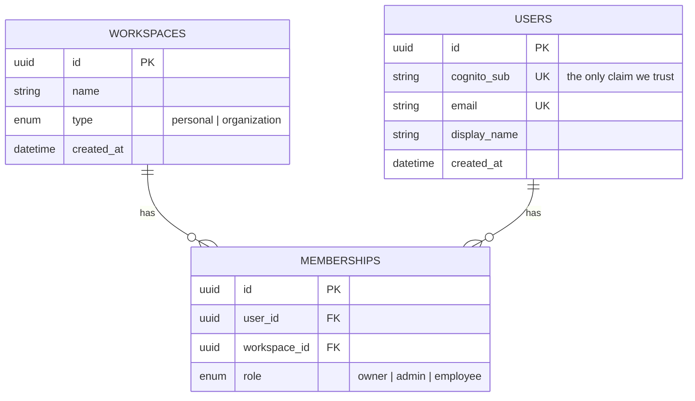
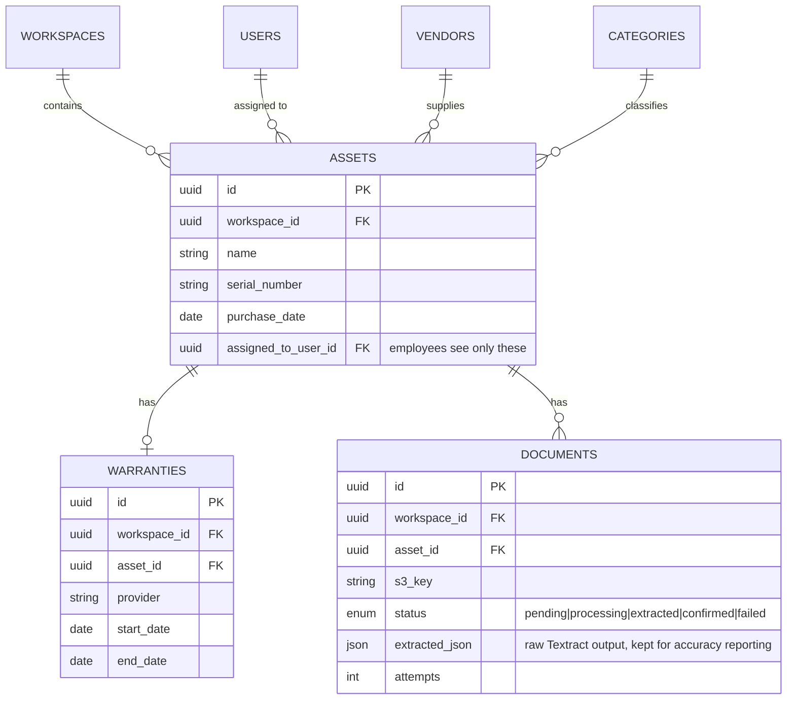

# Database Schema

Current tables live in `backend/app/models/`. Every schema change needs an
Alembic migration — CI runs `alembic check` and fails the build if a model was
changed without one.

## Now (migration `0001_initial_tenancy`)



`memberships` is unique on `(user_id, workspace_id)` — one role per person per
workspace.

## Planned

Each slice owner adds their own tables. **Every one of them carries
`workspace_id NOT NULL`** and is indexed on `(workspace_id, ...)`.



Departments and locations follow the same pattern when that slice starts.

## Adding a table

```bash
# 1. Write the model in backend/app/models/, import it in models/__init__.py
# 2. Generate the migration (needs the DB running: docker compose up db)
cd backend
alembic revision --autogenerate -m "add assets table"
# 3. Read the generated file — autogenerate is a first draft, not the answer
# 4. Apply and verify
alembic upgrade head
alembic check          # must say "No new upgrade operations detected"
```
