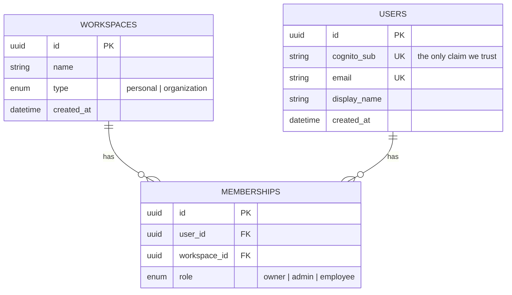
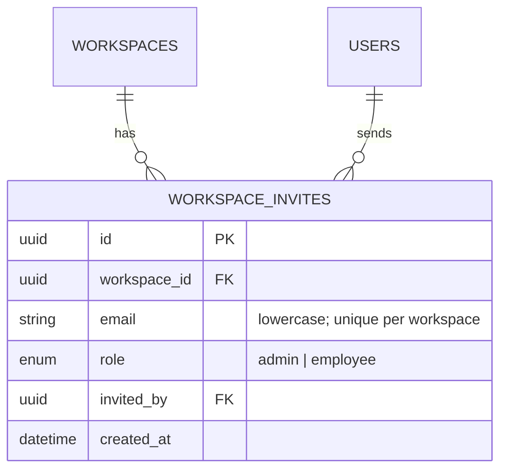
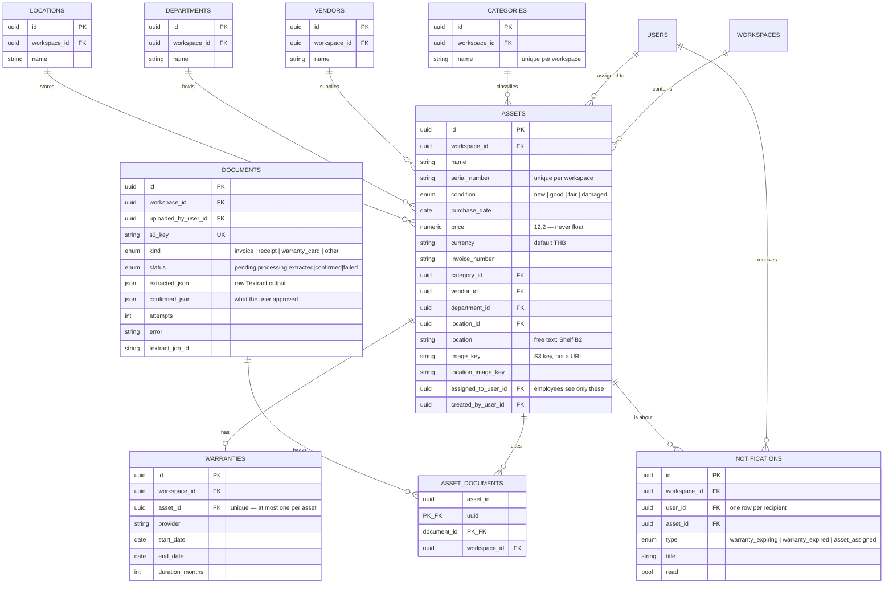

# Database Schema

Current tables live in `backend/app/models/`. Every schema change needs an
Alembic migration — CI runs `alembic check` and fails the build if a model was
changed without one.

## Tenancy (migration `0001_initial_tenancy`)



`memberships` is unique on `(user_id, workspace_id)` — one role per person per
workspace.

## Pending invitations (migration `0004_workspace_invites`)



An invitation is matched to the signed-in user's email. It remains separate
from `memberships` until accepted because the invited person may not have a
`users` row yet. Accepting creates a membership and removes the invitation in
one transaction; declining only removes it.

## Features (migration `0002_assets_documents`)

Eight more tables: the asset, its warranty, the documents it was proved by,
the four lookup lists, and the notification feed.

**Every one of them carries `workspace_id NOT NULL`**, and every index leads
with that column, because every query starts by narrowing to one workspace.



### Decisions worth knowing before you query this

**There is no `status` column on `warranties`, and there must not be one.**
Warranty status is a function of `end_date` and today's date, so a stored copy
is wrong as soon as the clock passes it. `warranty_service` computes it on
read; the rules are in [architecture.md](architecture.md). What *is* stored is
`end_date`, because that is what the dashboard, the expiring list and the
nightly e-mail job all filter on — hence the index on
`(workspace_id, end_date)`.

**Documents link to assets through a join table, not a column.** The draft ERD
had `documents.asset_id`, which cannot express either direction that actually
happens: one asset can have an invoice *and* a warranty card, and one invoice
with several line items becomes several assets that all cite it (which is why
`POST /documents/{id}/confirm` returns `created_asset_ids`, plural). A document
row is also created by `POST /documents/presign` *before* any asset exists, so
the column would start out NULL anyway.

**Deletes never cascade sideways.** `workspace_id` is `ON DELETE CASCADE` —
deleting a workspace takes its data. Everything else (`category_id`,
`vendor_id`, `department_id`, `location_id`, `assigned_to_user_id`,
`created_by_user_id`, `notifications.asset_id`) is `ON DELETE SET NULL`:
deleting a category or a user must not delete assets. A notification outlives
the asset it was about — it just stops being a link.

**`serial_number` is unique per workspace, not globally.** That is what makes
the bulk importer's `"serial_number": "duplicate"` error possible, while still
letting two organizations own hardware with the same serial.

**`locations` vs `assets.location`.** The table is the site picker ("HQ Floor
3"), the column is free text for the spot inside it ("Shelf B2"). `docs/api.md`
currently only returns the free-text one; if the detail payload should also
return `location: {id, name}` like category and vendor do, that is a contract
change for Leg A to make in api.md first.

**S3 keys, never URLs** (`image_key`, `location_image_key`, `documents.s3_key`).
The bucket is private and the API hands out short-lived presigned GETs, so a
stored URL would be expired by the time anyone read it.

**`asset_documents` carries a redundant `workspace_id`.** Both sides already
have one. It is there because the house rule is that every tenant-scoped table
has it, and the rule holds precisely because exceptions are where cross-tenant
leaks start.

## Adding a table

```bash
# 1. Write the model in backend/app/models/, import it in models/__init__.py
# 2. Generate the migration (needs the DB running: docker compose up db)
cd backend
alembic revision --autogenerate -m "add assets table"
# 3. Read the generated file — autogenerate is a first draft, not the answer
# 4. Apply and verify
alembic upgrade head
alembic check          # must say "No new upgrade operations detected"
```
